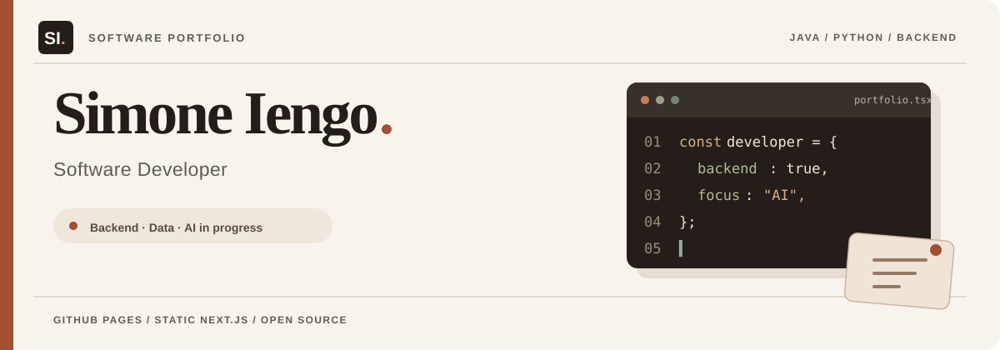
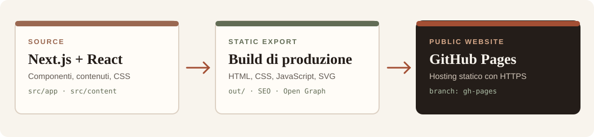

<div align="center">
  

  <br/>

  **Portfolio personale · Next.js · React · GitHub Pages**

  [**Visita il portfolio**](https://ilmuratore.github.io/portfolio/) &nbsp;·&nbsp;
  [**Progetti**](https://ilmuratore.github.io/portfolio/projects/) &nbsp;·&nbsp;
  [**Chi sono**](https://ilmuratore.github.io/portfolio/about/) &nbsp;·&nbsp;
  [**Contatti**](https://ilmuratore.github.io/portfolio/contact/)
</div>

---

## Il progetto

Portfolio web di **Simone Iengo**, Software Developer junior con esperienza in **Java, Spring Boot, Python e sviluppo backend**, e interesse per l'AI engineering come direzione di crescita professionale.

Il sito presenta una selezione di repository pubblici, competenze tecniche e percorso professionale attraverso un'interfaccia editoriale responsive. È costruito con componenti riutilizzabili e distribuito come **sito statico**, senza server applicativo, database o servizi di terze parti necessari alla navigazione.

### Caratteristiche

- **Design responsive** con palette crema, terracotta e oliva; navigazione mobile e supporto alla tastiera.
- **Catalogo progetti** con filtri, schede tecniche, architetture e collegamenti ai repository.
- **Profilo professionale** con esperienze, competenze, formazione e contatti verificabili.
- **Asset locali**: icone SVG, favicon, font e anteprime illustrative.
- **SEO statico**: metadati, Open Graph, Twitter card, sitemap e `robots.txt`.
- **Pubblicazione su GitHub Pages** tramite export Next.js e script di deploy manuale.

## Tecnologie

<div align="center">
  <table>
    <tr>
      <td align="center" width="150"><br/><b>Next.js</b><br/><sub>App Router 16</sub></td>
      <td align="center" width="150"><br/><b>React</b><br/><sub>Componenti 19</sub></td>
      <td align="center" width="150"><br/><b>JavaScript</b><br/><sub>ES modules / JSX</sub></td>
      <td align="center" width="150"><br/><b>GitHub Pages</b><br/><sub>Hosting statico</sub></td>
    </tr>
  </table>
</div>

**Interfaccia:** Tailwind CSS 4 e CSS personalizzato. **Tooling:** Node.js, npm, ESLint, PostCSS, test nativi `node:test`.

## Architettura



I contenuti sono versionati nel repository e le pagine progetto vengono generate da `generateStaticParams()`. L'export pubblico produce la cartella `out/`, completa di asset con `basePath` corretto, metadati SEO e immagini social PNG.

```text
src/
├── app/
│   ├── components/site/     # Componenti e sezioni condivisi
│   ├── about/               # Percorso professionale
│   ├── contact/             # Contatti
│   ├── projects/            # Catalogo e case study
│   ├── globals.css          # Design e responsive
│   └── layout.js            # Layout e metadata
├── config/site.js           # URL e configurazione SEO
└── content/
    ├── projects.mjs         # Progetti e filtri
    ├── profile.mjs          # Profilo e competenze
    ├── process.mjs          # Processo di lavoro
    └── icon-map.mjs         # Loghi delle tecnologie

public/icons/tech/           # Icone SVG locali
assets/                      # Grafica del README
scripts/                     # Build, verifiche e pubblicazione
tests/                       # Test automatici
```

## Esecuzione locale

**Requisiti:** Node.js compatibile con Next.js 16 (almeno 20.9) e npm.

```bash
git clone https://github.com/ilmuratore/portfolio.git
cd portfolio
npm ci
npm run dev
```

Apri **http://localhost:3000**.

### Test e controlli

```bash
npm run verify
npm run verify:static
npm run verify:pages
npm run security:check
npm audit
```

| Comando | Scopo |
| --- | --- |
| `npm run verify` | Test automatici, lint e build Next.js |
| `npm run verify:static` | Export di anteprima non indicizzabile e verifica dei file |
| `npm run verify:pages` | Export pubblico e verifica di pagine, link, SEO e immagini |
| `npm run security:check` | Controllo delle versioni minime delle dipendenze |
| `npm audit` | Segnalazioni di sicurezza delle dipendenze npm |

Il controllo `npm audit` può segnalare advisory nella toolchain di build: valutarli singolarmente prima di modificare forzatamente le dipendenze.

## Pubblicazione

Il portfolio è pubblicato gratuitamente su **GitHub Pages**:

**[ilmuratore.github.io/portfolio](https://ilmuratore.github.io/portfolio/)**

La pubblicazione è manuale e consentita solo dal branch `main` con working tree pulito.

```bash
git switch main
git pull --ff-only origin main
npm ci
npm run deploy:pages
```

Il comando compila il sito, verifica l'export, prepara le immagini social e pubblica **solo i file statici** sul branch `gh-pages`, usando `--force-with-lease` quando serve. La sorgente di GitHub Pages è configurata su **`gh-pages` / `(root)`**.

Non è richiesto un dominio a pagamento; in caso di dominio personalizzato occorre aggiornare URL canonici, `basePath` e impostazioni DNS.

## Progetti presentati

| Progetto | Tecnologie principali | Repository |
| --- | --- | --- |
| **Banca Python** | Python · PostgreSQL · Pandas | [Codice](https://github.com/ilmuratore/banca-python) |
| **Python Developer AI** | Python · FastAPI · SQLite | [Codice](https://github.com/ilmuratore/python-developer-ai) |
| **AziendaJava** | Java · Spring Boot · JPA | [Codice](https://github.com/ilmuratore/AziendaJava) |

Le schede si basano sui contenuti disponibili nei repository. Le anteprime grafiche del portfolio sono **illustrazioni**, non screenshot delle applicazioni. Alcuni progetti hanno finalità formative o sperimentali.

## Licenza e risorse

Il codice è distribuito secondo la licenza [MIT](./LICENSE).

I loghi delle tecnologie provengono da [Simple Icons](https://github.com/simple-icons/simple-icons) e sono usati unicamente per identificare prodotti e strumenti. I relativi marchi rimangono dei rispettivi titolari; consultare le condizioni e le linee guida specifiche.

---

<div align="center">
  <sub>Simone Iengo · Software Developer · Java / Python / Backend</sub>
  <br/>
  <a href="https://github.com/ilmuratore">GitHub</a> ·
  <a href="https://www.linkedin.com/in/simone-iengo-557914109/">LinkedIn</a> ·
  <a href="https://ilmuratore.github.io/portfolio/">Portfolio</a>
</div>
